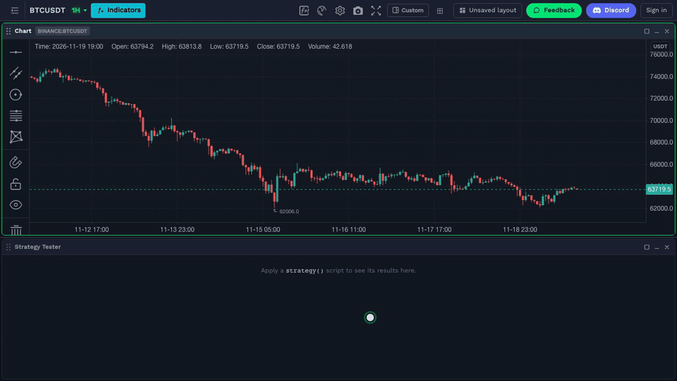
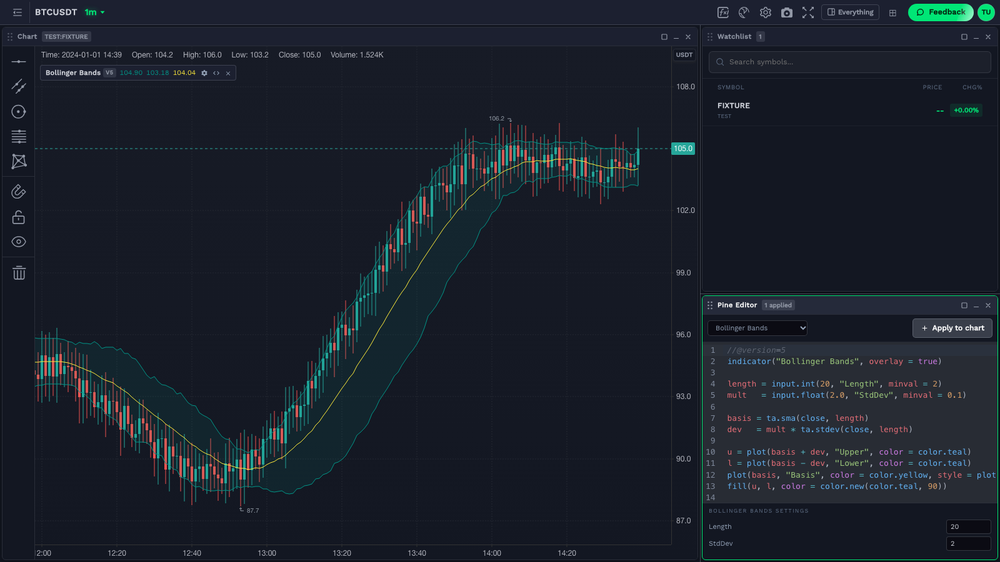
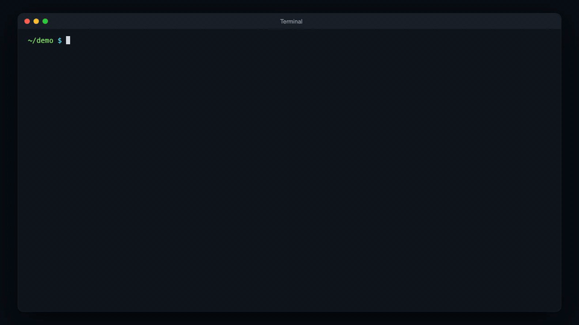
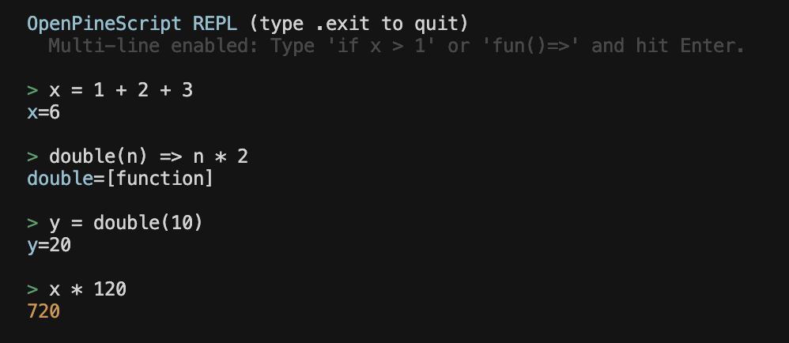

<div align="center">

# OpenPineScript

**The free, open-source Pine Script engine: run TradingView Pine Script v1–v6 locally, verified against TradingView.**<br>
No TradingView account, no cloud, no execution quota. GPL-3.0.

[](https://github.com/be-thomas/OpenPineScript/releases)
[](https://www.npmjs.com/package/openpinescript)
[](https://www.npmjs.com/package/openpinescript)
[](https://pypi.org/project/openpinescript/)
[](docs/common/CONFORMANCE.md)
[](docs/common/CONFORMANCE.md#testing)
[](LICENSE)
[](https://github.com/be-thomas/OpenPineScript/stargazers)

### [Documentation](https://be-thomas.github.io/OpenPineScript/) &nbsp;·&nbsp; [Try it in your browser (Zeal Terminal)](https://zealterminal.com) &nbsp;·&nbsp; [Releases](https://github.com/be-thomas/OpenPineScript/releases) &nbsp;·&nbsp; [Community](https://discord.gg/rmyXDFJK2k)

[](https://zealterminal.com)

<sub>Zeal Terminal, built on this engine.</sub>

</div>

---

**OpenPineScript is an open-source Pine Script engine**, a TradingView
alternative and Pine Script backtester for running Pine Script on your own machine. It transpiles TradingView
Pine Script (`.pine`) to JavaScript and runs it against your own candles — so you
can **backtest Pine Script offline**, run a Pine indicator in CI,
convert Pine Script to JavaScript for embedding elsewhere, or batch-test
thousands of scripts without touching a browser.

Pine Script **v1, v2, v3, v4, v5 and v6** are implemented, each with its own
grammar and its own emitter.

```
=== v4-essential-strategies-00.pine — Summary ===
Bars processed : 506
Plots recorded : 1

Performance:
  Initial Capital    $100000.00
  Net Profit         +$234.90 (+0.23%)
  Total Trades       99
  Win Rate           59.6%  (59W / 39L)
  Profit Factor      1.47
  Max Drawdown       $209.30 (0.21%)
  Avg Win / Avg Loss $12.45 / $12.81
```

<sub>One of TradingView's own documentation examples, unedited, run locally.</sub>

---

## 🌲 Zeal Terminal: a free TradingView alternative built on this engine

Not everyone wants to clone a repository to find out whether an engine handles
their script. **[Zeal Terminal](https://zealterminal.com)** is a charting workspace
built on OpenPineScript — this engine, compiled to a Web Worker and running
inside the browser tab.

[](https://zealterminal.com)

<div align="center">

### **[▶ Get Open Beta Access at zealterminal.com](https://zealterminal.com)**

<sub>Open beta — free, and open to anyone with a Google account.</sub>

</div>

Paste a script, press apply, and watch it draw. The engine runs on your own
machine, so there is no compile queue and no round trip to wait for — the same
properties this repository gives you at the command line, with a chart attached.

- **Runs Pine Script v1–v6 unchanged.** Paste a script, press Apply; an old v1 to v3 script does not need upgrading first.
- **Local execution.** This engine in a Web Worker in your browser tab: no compile queue, no server round trip.
- **Unlimited indicators, no ads, free.** No paid tier raises a cap.
- **A strategy tester** with commission and slippage, with the fill rules written out on the site and in this repository.
- **Checked against TradingView's own output.** The engine underneath is the one this repository verifies, and it is open source, GPL-3.

Zeal Terminal is an independent project, not affiliated with TradingView, Inc. It is a separate product and its workspace is proprietary; **the engine
underneath it is this repository, GPL-3 and public**, so the arithmetic behind
any backtest it shows you can be read here rather than taken on trust.

<sub>Screenshot: Bollinger Bands drawn from the Pine source beside it, on sample data.</sub>

---

## ⚡ Quick start

Run any Pine script against a CSV of bars, with nothing to install (Node.js 20 or newer):

```bash
npx openpinescript my_script.pine --data candles.csv
```



`candles.csv` is one bar per row, `time,open,high,low,close,volume`, with `time` as ISO 8601 or Unix epoch
seconds or milliseconds.

Use the engine from JavaScript:

```bash
npm install openpinescript
```

```js
import { Session } from "openpinescript";
```



---

## 🎯 Why OpenPineScript

- **Free and open source.** GPL-3.0, with the grammar, emitter and broker emulator all in this repository: a TradingView alternative whose arithmetic you can read.
- **No account, no quota.** Your data, your machine, your loop budget. No rate limit, no network, no execution cap.
- **Private.** Your scripts and data stay on your machine; nothing is uploaded.
- **Verified against TradingView.** 112 indicator, control-flow and broker columns matched **bar for bar** against TradingView's own output. Not against a spec, against the platform.
- **Every version, v1–v6.** Each has its own grammar and emitter, so a v2 script is parsed by a parser that has never heard of `var`.
- **JavaScript and Python.** `npm install openpinescript` / `pip install openpinescript`. Pine Script to JavaScript: emit readable JS and embed it in a worker, a server, a browser or a CI job. Pine Script in Python: a thin wrapper over the same engine.
- **Built for automation.** JSON output, exit codes, input overrides, and a comparison mode that diffs your run against a TradingView export.
- **4,400+ tests.** Differential testing against an independent oracle, a full version matrix, 763 real scripts from TradingView's docs, and the parity suites above.

---|---|
| 📊 **Numbers you can trust** | 112 indicator, control-flow and broker columns matched **bar for bar** against TradingView's own output. Not against a spec — against the platform. |
| 🔌 **Completely offline** | Your data, your machine, your loop budget. No account, no quota, no rate limit, no network. |
| 🗂️ **Six language versions** | v1 → v6, each with its own grammar and emitter, so a v2 script is parsed by a parser that has never heard of `var`. |
| 🔁 **Pine → JavaScript** | Emit readable JS and embed it anywhere — a worker, a server, a browser, a CI job. |
| 🤖 **Built for automation** | JSON output, exit codes, input overrides, and a comparison mode that diffs your run against a TradingView export. |
| 🧪 **4,400+ tests** | Differential testing against an independent oracle, a full version matrix, 763 real scripts from TradingView's docs, and the parity suites above. |

---

## 🎖️ Verified against TradingView itself

Most engines are tested against a specification or a reference implementation.
Neither catches an indicator that is subtly and **consistently** wrong.

So nine harness scripts were run **inside TradingView**, their per-bar output
copied back out, and replayed here against the same candles:

<div align="center">

### **112 columns · ~2,474 bars each · tolerance 1e-6 · all agree**

</div>

A further **38 indicators** are anchored to values TradingView's own screener
computed, from a frozen fixture that runs unattended on every commit.

This process found **eleven defects** that every other kind of test had missed —
including a Parabolic SAR that was the textbook algorithm rather than
TradingView's, market orders filling a bar early at the wrong price, and a VWAP
that never reset at session boundaries.

> 📖 **[Read the full conformance report →](docs/common/CONFORMANCE.md)**
> Every harness, every defect, how the data is collected — and an honest account
> of [what is *not* covered yet](docs/common/CONFORMANCE.md#what-is-not-covered).

---

## 🗂️ Supported Pine Script versions

The `//@version` annotation selects the language version; a script without one is v1.

| Version | State | What it adds |
|---------|-------|--------------|
| **v1** | ✅ Implemented | The base language |
| **v2** | ✅ Implemented | `:=` |
| **v3** | ✅ Implemented | A five-item tightening of v2 |
| **v4** | ✅ Implemented | `var` / `varip`, arrays, drawing objects, the namespace migration |
| **v5** | ✅ Implemented | `while`, `switch`, user-defined types, methods, libraries, matrices, maps, Pine Logs, the `ta.*` / `math.*` / `str.*` migration |
| **v6** | ✅ Implemented | The migration guide's rules — strict bools, lazy `and`/`or`, dynamic `for` bounds, negative array indices, margin enforcement, `strategy.exit()` parameter pairs — plus `once`, multiline strings, `request.footprint()`, text formatting, library constants and `sort_field` |

Roughly **270 standard-library names** are implemented, along with the strategy
broker emulator, multi-timeframe `security()`, and the real-time tick model.

---

## 🛠️ What you can build with it

- **Backtest Pine Script strategies offline** on years of your own data, with no execution cap
- **Run indicators in CI** and fail a build when a signal changes
- **Convert Pine Script to JavaScript** and embed it in a product
- **Batch-screen thousands of scripts** in parallel
- **Diff against TradingView** with `--compare-dir` to measure agreement on your own script
- **Put it behind a chart** — [zealterminal.com](https://zealterminal.com) is this engine in a browser tab, in open beta, if you want to see that shape working before you build it

```bash
npx openpinescript strategy.pine --data data.csv --out-dir ./results
```

> 📖 **[Full CLI reference →](CLI-Usage.md)** — output flags, comparison mode,
> input overrides, structured output, debug flags.

---

## 📚 Documentation

| Doc | What it answers |
|---|---|
| **[Docs site](https://be-thomas.github.io/OpenPineScript/)** | The CLI guide, a five-lesson tutorial that runs the real engine in your browser, and a guide written for AI agents |
| **[Conformance report](docs/common/CONFORMANCE.md)** | How the numbers are verified, what that caught, what is not covered |
| **[CLI usage](CLI-Usage.md)** | Every flag, with worked examples |
| **[Architecture](docs/common/ARCHITECTURE.md)** | The compile pipeline and the repository layout |
| **[Golden-data recipe](conformance/common/golden.md)** | How to collect a new TradingView export |
| **[Integration guide](docs/common/integration/README.md)** | Embedding the engine in a charting UI: plotting, strategies, live ticks |
| **[Pine versions](docs/common/VERSIONS.md)** | What each version, v1 to v6, changes and where the engine implements it |
| **[Deliberate omissions](docs/common/CONFORMANCE.md#restrictions-the-engine-does-not-enforce)** | The TradingView limits and checks the engine does not apply |

---

## ❓ FAQ

<details>
<summary><b>Is there a chart? Can I see a script actually draw?</b></summary>
<br>

Yes — at **[zealterminal.com](https://zealterminal.com)**. Zeal Terminal is a charting
workspace that runs this engine in a Web Worker in your browser: paste a script,
press apply, and it draws. Nothing to install and no CSV to find.

The workspace itself is a separate, proprietary product. The engine underneath
it is this repository, GPL-3 and public.
</details>

<details>
<summary><b>Can I run Pine Script without a TradingView account?</b></summary>
<br>

Yes. That is the point of the project. OpenPineScript compiles and executes Pine
Script entirely on your machine, against CSV data you supply. Nothing is sent
anywhere and no account is involved.
</details>

<details>
<summary><b>Does it support Pine Script v5?</b></summary>
<br>

Yes — v5 is implemented, including user-defined types, methods, libraries,
`while`, `switch`, matrices, maps, enums and Pine Logs, along with the `ta.*`,
`math.*`, `str.*` and `request.*` namespace migration. v1 through v4 are
implemented too.
</details>

<details>
<summary><b>Does it support Pine Script v6?</b></summary>
<br>

Yes. v6 has its own grammar and emitter, inheriting from v5's, so adding it did
not change what any v1–v5 script compiles to. It covers TradingView's v6
migration guide and the release notes through September 2026.

One caveat worth knowing before relying on v6 strategy numbers: the v1–v5
broker columns are matched against TradingView's own output, and v6's are not
yet. v6 changes the broker — `strategy.exit()` takes whichever paired level
triggers first, and margin is enforced by default — and those rules are
implemented from TradingView's documentation without captured fixtures to check
them against. The same goes for `request.footprint()`'s Value Area and
imbalance rules, which the documentation leaves partly unstated.
</details>

<details>
<summary><b>Will results match TradingView exactly?</b></summary>
<br>

Where it has been measured, yes. 112 columns are compared bar for bar against
output collected from TradingView, at a relative tolerance of 1e-6, and all of
them agree. That covers roughly a tenth of the standard library, concentrated in
`ta.*`, `math.*` and `strategy.*` — the
[conformance report](docs/common/CONFORMANCE.md#what-is-not-covered) says plainly what
is not covered.

To measure it on *your* script, use `--compare-dir` against a TradingView export.
</details>

<details>
<summary><b>Can I use it to backtest a strategy?</b></summary>
<br>

Yes. `strategy()` scripts run against a broker emulator that models order
timing, fill prices, gaps, tick rounding and brackets the way TradingView's
does — each of those rules measured against TradingView's own backtest output
rather than assumed.
</details>

<details>
<summary><b>Is it a Pine Script interpreter or a compiler?</b></summary>
<br>

A compiler. Pine source is parsed by an ANTLR-generated parser into a syntax
tree, and a version-specific visitor emits JavaScript, which is then executed
bar by bar against a runtime that provides the standard library.
</details>

<details>
<summary><b>How do I convert Pine Script to JavaScript?</b></summary>
<br>

`npx openpinescript script.pine --data data.csv --show-transpiled` prints the
compiled JavaScript before running it, or call `compileScript(src)` from the
library (`import { compileScript } from "openpinescript"`) to get it as a string.
</details>

---

## 💬 Community

Questions or a script that won't run? Join the [Zeal Terminal Discord](https://discord.gg/rmyXDFJK2k). I help fix Pine scripts live in a voice channel.

---

## 🤝 Contributing

The core is developed by a single author and pull requests are not being
accepted, but **bug reports and feature requests drive the roadmap**. See
[CONTRIBUTING.md](CONTRIBUTING.md), the [Code of Conduct](CODE_OF_CONDUCT.md),
and the [Security Policy](SECURITY.md).

Writing a golden-data harness is the single highest-value contribution to the
project — the [recipe is here](conformance/common/golden.md).

## 📄 License

GNU GPL-3.0. See [LICENSE](LICENSE).

The Pine Script language and TradingView are trademarks of TradingView, Inc.
This project is not affiliated with or endorsed by TradingView. The examples in
[`examples/<version>/tradingview-docs/`](examples/common/tradingview-docs/README.md)
are © TradingView, reproduced verbatim for interoperability testing and not
covered by the licence above.

---

<div align="center">

**If this saved you a TradingView quota, a ⭐ helps others find it.**

<sub>Keywords: Pine Script, TradingView, Pine Script v5, Pine Script v4, Pine Script compiler,
Pine Script interpreter, Pine to JavaScript, run Pine Script locally, offline backtesting,
Pine Script backtest, algorithmic trading, technical analysis library, ANTLR, TypeScript,
open source trading, trading indicator engine.</sub>

</div>
