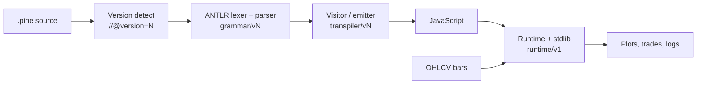

# Architecture and repository layout

> How a `.pine` file becomes JavaScript and then numbers. For the development
> plan and iteration history see [dev-docs/](../../dev-docs/README.md); for the
> parity evidence see [CONFORMANCE.md](CONFORMANCE.md).

## The pipeline

Each version has its **own grammar and its own emitter**, and the emitters
inherit: `V1ToJsVisitor ← V2 ← V3 ← V4 ← V5`. Adding a version does not mean
editing an earlier one, which is what keeps a v5 feature from silently
relaxing a v2 rule.

The **runtime is shared**. There is one implementation of each built-in, in
`runtime/v1/stdlib/`, and the version machinery decides which *names* resolve
to it — `BASE_REGISTRY` (v1–v3) → `V4_VIEW` → `V5_VIEW`. A fix to an indicator
is therefore a fix at every version at once.

## Repository layout

Every top-level folder partitions its contents the same way: child folders are
named `v1`–`v5` for version-specific code and `common` for anything shared. The
grammars are the one place this costs something — ANTLR resolves composite
`import` chains through a single `--lib` directory, so
[`scripts/common/build-grammars.mjs`](../../scripts/common/build-grammars.mjs) stages
every `.g4` into one temporary folder at build time and deletes it afterwards.

| Path | Contents |
|------|----------|
| [`grammar/`](../../grammar/) | ANTLR lexer and parser grammars (`.g4`), one pair per version |
| [`lexer/`](../../lexer/) | Token source that turns indentation into block tokens |
| [`parser/`](../../parser/) | Generated ANTLR parsers and the parse entry point |
| [`transpiler/`](../../transpiler/) | Parse tree to JavaScript, one emitter per version |
| [`runtime/`](../../runtime/) | Execution context, series storage, standard library, broker emulator |
| [`repl/`](../../repl/) | Interactive REPL |
| [`mock_run/`](../../mock_run/) | CLI runner |
| [`utils/`](../../utils/) | Shared helpers and the TradingView comparison engine |
| [`tests/`](../../tests/) | Test suites, by version |
| [`conformance/`](../../conformance/) | The cross-version rule matrix and golden outputs |
| [`examples/`](../../examples/) | Hand-written samples and the TradingView documentation corpus |
| [`validation/`](../../validation/) | Real-world Pine scripts used for parity checking |
| [`spec/`](../../spec/) | Language specification and per-version progress checklists |
| `dev-docs/` | Development plan for v1–v5 (local only, not published) |
| [`mock_data/`](../../mock_data/) | Sample OHLCV data |
