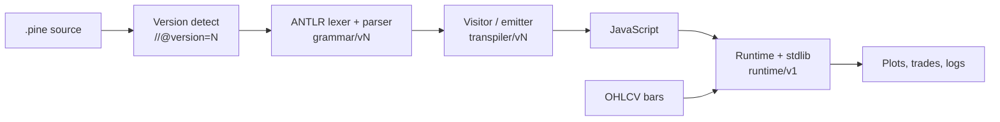

# Architecture and repository layout

> How a `.pine` file becomes JavaScript and then numbers. For the development
> plan and iteration history see [dev-docs/](../../dev-docs/README.md); for the
> parity evidence see [CONFORMANCE.md](CONFORMANCE.md).

## The pipeline

Each version has its **own grammar and its own emitter**, and the emitters
inherit: `V1ToJsVisitor ← V2 ← V3 ← V4 ← V5`. Adding a version does not mean
editing an earlier one, which is what keeps a v5 feature from silently
relaxing a v2 rule.

The **runtime is shared**. There is one implementation of each built-in, in
`runtime/v1/stdlib/`, and the version machinery decides which *names* resolve
to it — `BASE_REGISTRY` (v1–v3) → `V4_VIEW` → `V5_VIEW`. A fix to an indicator
is therefore a fix at every version at once.

## Repository layout

Every top-level folder partitions its contents the same way: child folders are
named `v1`–`v6` for version-specific code and `common` for anything shared. The
grammars are the one place this costs something — ANTLR resolves composite
`import` chains through a single `--lib` directory, so
[`scripts/common/build-grammars.mjs`](../../scripts/common/build-grammars.mjs) stages
every `.g4` into one temporary folder at build time and deletes it afterwards.

| Path | Contents |
|------|----------|
| [`grammar/`](../../grammar/) | ANTLR lexer and parser grammars (`.g4`), one pair per version |
| [`lexer/`](../../lexer/) | Token source that turns indentation into block tokens |
| [`parser/`](../../parser/) | Generated ANTLR parsers and the parse entry point |
| [`transpiler/`](../../transpiler/) | Parse tree to JavaScript, one emitter per version |
| [`runtime/`](../../runtime/) | Execution context, series storage, standard library, broker emulator |
| [`repl/`](../../repl/) | Interactive REPL |
| [`mock_run/`](../../mock_run/) | CLI runner |
| [`utils/`](../../utils/) | Shared helpers and the TradingView comparison engine |
| [`tests/`](../../tests/) | Test suites, by version |
| [`conformance/`](../../conformance/) | The cross-version rule matrix and golden outputs |
| [`examples/`](../../examples/) | Hand-written samples and the TradingView documentation corpus |
| [`validation/`](../../validation/) | Real-world Pine scripts used for parity checking |
| [`spec/`](../../spec/) | Language specification and per-version progress checklists |
| `dev-docs/` | Development plans (local only, not published) |
| [`mock_data/`](../../mock_data/) | Sample OHLCV data |

## Performance invariants

Two optimizations make long runs (100,000+ bars) affordable. Each is correct only while an invariant holds, and none of it shows in the code that would break it, so each has a guard test that fails when it is removed or invalidated.

**Shared exit walk.** *What:* an exit with only absolute levels and no trail (`profit`, `loss`, `trail_price`, `trail_points` all NaN) is walked once per bar for all its units (`levelsFixed` / `shared` in `Broker.processPendingOrders`), and `hasUnit` scans newest-first instead of `units.some`. *Why:* a strategy that re-issues one `strategy.exit` per bar while reversing leaves thousands of unfilled units, and walking each made a run quadratic: 108,900 bars went from 127 s to 5.3 s. *Invariant:* for such an exit `Broker.walkExit` reads nothing from the unit or `basis` and has no side effect; if it ever does, `levelsFixed` must narrow in the same edit. *Guards:* `tests/v1/runtime/broker_exit_sharing.test.ts`. *Code:* `runtime/v1/broker/Broker.ts`.

**Lazy rollback points in history runs.** *What:* a history run snapshots call-site state per bar only at sites known to repeat on a bar (`Context.repeatingSites`). A repeat it missed throws (`missedRepeat`) and `Session.runHistory` restarts with that site added; after 4 restarts it snapshots everything. *Why:* cloning every stateful site every bar was about 70% of a long run: 77 s became 11.8 s. *Invariants:* results equal those of a run that snapshots everything; live and forming bars snapshot every site, so `repeatingSites` is null after history; a restart reruns the history, so the only thing a run may report to the host before it returns is `onProgress` (an alerts, logs or drawings callback would be emitted twice). *Guards:* `tests/v1/runtime/lazy_rollback_points.test.ts` (results), `tests/v1/runtime/rollback_snapshot_work.test.ts` (cloning spared, live re-tick unchanged). *Code:* `runtime/v1/context.ts`, `runtime/v1/session.ts`.

**How they were measured.** Timings are from a real 108,900-bar file run through `Session.runHistory`, before and after. Behaviour was checked by running 196 scripts on `main` and on the branch and comparing the output byte for byte: all identical.
